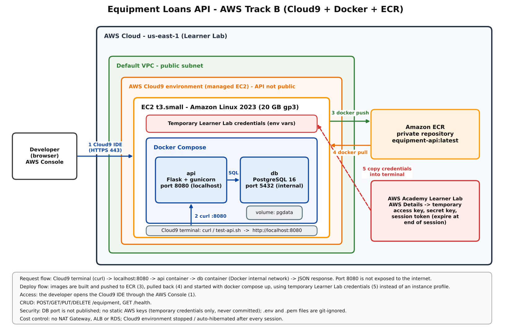

# Equipment Loans API (AWS Track B: Cloud9 (EC2) + Docker + ECR)

Individual project, AWS Cloud Computing. A small REST API for managing equipment loans.

## Architecture



```
Developer -> AWS Console -> Cloud9 environment (EC2 t3.small, Amazon Linux 2023)
                              +-- docker compose
                                   +-- api  (Flask + gunicorn, image pulled from ECR)
                                   |     |
                                   |     v  internal Docker network
                                   +-- db   (postgres:16-alpine, volume pgdata, no public port)

Testing: curl / test script inside the Cloud9 terminal -> http://localhost:8080
```

| Component | Purpose |
|---|---|
| ECR `equipment-api` | Private registry for the API image |
| Cloud9 environment (EC2 t3.small) | Development and runtime host; runs both containers with Docker Compose |
| Temporary Learner Lab credentials | Used by AWS CLI to log in to ECR and push/pull the image |

Architecture diagram: `docs/architecture.png`

> Note: a standalone EC2 instance could not be used in the Learner Lab, so the same EC2-based setup is
> run through Cloud9. The API is not exposed publicly; it is tested through `localhost`.

## Entity

`equipment`: `id`, `name`, `category`, `status` (`available` | `borrowed`), `borrower`, `created_at`

## API

| Method | Endpoint | Description |
|---|---|---|
| GET | `/health` | Health and DB connectivity check |
| POST | `/equipment` | Create item (`name`, `category`) |
| GET | `/equipment` | List items |
| GET | `/equipment/{id}` | Item detail |
| PUT | `/equipment/{id}` | Update item / borrow (`status`, `borrower`) |
| DELETE | `/equipment/{id}` | Delete item |

## Run locally

```bash
cp .env.example .env      # edit DB_PASSWORD
docker compose up -d --build
./scripts/test-api.sh http://localhost:8080
```

## Deployment plan (AWS Learner Lab, us-east-1)

1. Start Learner Lab, open the AWS Console.
2. Create private ECR repository `equipment-api`.
3. Create a Cloud9 environment (new EC2 instance, Amazon Linux 2023) and open its terminal.
4. Make sure Docker and the Compose plugin are available (install them if missing) and clone this repo:
   ```bash
   docker --version && docker compose version
   git clone https://github.com/arimbiarumsari/equipment-loans.git && cd equipment-loans
   ```
5. Set the temporary Learner Lab credentials in the terminal (from *AWS Details* in Learner Lab):
   ```bash
   export AWS_ACCESS_KEY_ID=...
   export AWS_SECRET_ACCESS_KEY=...
   export AWS_SESSION_TOKEN=...
   export AWS_DEFAULT_REGION=us-east-1
   ```
   These expire when the lab session ends, so repeat this step in every new session.
6. Create `.env` from `.env.example` (set account ID, image URI, password).
7. Build and push image: `./scripts/push-image.sh`
8. Deploy: `./scripts/deploy.sh`
9. Verify from the Cloud9 terminal: `./scripts/test-api.sh http://localhost:8080`

## Security notes

- DB port is not published; only the `api` container can reach it.
- API port 8080 is not opened to the internet; access is via `localhost` only.
- No static AWS keys: only temporary Learner Lab credentials, exported in the terminal session and never written to the repo.
- `.env` and `*.pem` are git-ignored.

## Evidence

Screenshots and outputs are stored in `docs/evidence/`.
